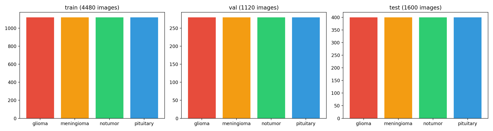

# Brain Tumor MRI Classification — and an audit of the benchmark everyone gets 99% on

Four-class brain-tumor MRI classification (glioma / meningioma / pituitary / no tumor) on the most-used public dataset for this task — built as an honest pipeline that audits its own benchmark before trusting its own numbers.

**The short version:** I trained six models (a 90k-parameter baseline plus five lightweight architectures) on the "Brain Tumor MRI Dataset" and got **96.31% accuracy** on its sealed 1,600-image test set — consistent with the 99%-class results this benchmark usually produces. Then I audited the benchmark itself: **73% of the test images (1,162 of 1,600) share a perceptual hash with the training split** — MRI slices of the *same patients* on both sides of the split. On the 438 genuinely uncontaminated test images, the best model scores **89.50%** — a 6.8-point leakage premium that every 99% headline on this dataset is silently collecting. The best model is stable across three seeds (**95.92% ± 0.28 pp**), and its errors concentrate where clinicians find them hard too (glioma → meningioma).

> **Headline claim: 96.31% is what this benchmark reports. 89.5% is the honest estimate on its uncontaminated portion. The gap is the finding.**

---

## Why this project looks the way it does

This is a rebuild of an earlier course project that reported 99.31%. A forensic re-audit of that original run found it had trained on CPU while being presented as a cloud-GPU run, executed with a **broken scikit-learn** (its `roc_auc_score` literally returned 0.5 — every metric was a homemade approximation), and duplicated rows across sessions. Rather than patch the numbers, I rebuilt the pipeline from scratch with the discipline the original lacked: stage-gated execution, atomic artifacts, real metrics, seeded everything, and a data-quality audit *before* trusting any accuracy. The full original-flaws → fixes table is in [the notebook](notebooks/brain_tumor_mri_v2_t4.ipynb).

The rebuild's headline number came out ~3 points *lower* than the original's — which prompted the obvious question: why do all projects on this dataset hover near 99%? The audit below is the answer.

## The data — and its leakage problem

**Dataset:** [Brain Tumor MRI Dataset](https://www.kaggle.com/datasets/masoudnickparvar/brain-tumor-mri-dataset) by Masoud Nickparvar (CC BY 4.0), Version 2 (updated Feb 2026), 5,600 training / 1,600 testing images, balanced 1,400/400 per class. It combines three public collections — the [Figshare dataset (Cheng)](https://figshare.com/articles/dataset/brain_tumor_dataset/1512427), the [SARTAJ dataset](https://www.kaggle.com/datasets/sartajbhuvaji/brain-tumor-classification-mri), and [Br35H](https://www.kaggle.com/datasets/ahmedhamada0/brain-tumor-detection) — MRI scans of ~233 patients total, slice-level.

Version 2 already did real cleaning: it removed duplicates, balanced the classes, and **eliminated exact train/test overlap**. My audit (exact MD5 hashing + perceptual hashing, pHash Hamming ≤ 8) confirms the exact-copy overlap is now zero — but the deeper problem survives, because *slice-level scans of the same patient sit on both sides of the split*:

| Audit finding (this run) | Count |
|---|---|
| Exact train↔test copies (the flaw Version 2 fixed) | **0** |
| Test images with a near-duplicate (pHash ≤ 8) somewhere in the raw Training folder | 1,248 / 1,600 (78%) |
| Test images with a near-duplicate in the **actual 4,480-image training split** | **1,162 / 1,600 (73%)** |
| Exact duplicate files within train / within test | 171 / 16 |

This is not an exotic discovery — it independently reproduces what 2025 medical-imaging literature reports for this exact dataset family (see *Related work*). But most projects using it still quote 99%+ with no disclosure. The audit is a first-class pipeline stage here (Stage 2), and the honest re-scoring (Stage 11) is the headline result.

**One rule this project enforces:** accuracies are never compared across dataset editions. The 99.31% of the original project and the 96.31% here were scored on *different* test sets (Version 1 vs Version 2) — only the numbers inside one run are comparable.



## What the pipeline does

Every stage writes its artifacts to disk and marks itself complete in a manifest; re-running skips finished work, interrupted training resumes mid-epoch, and the comparison table is rebuilt from per-model JSON records (a duplicate row is structurally impossible):

| Stage | What it does |
|---|---|
| 1–4 | Environment record, dataset integrity check, duplicate/near-duplicate audit, seeded split + EDA |
| 5–6 | Training infrastructure; **BaselineCNN** (~90k params) then five lightweight architectures, one at a time, each evaluated **once** on the sealed test set |
| 7 | Comparison table (fresh from per-model JSONs) |
| 8 | Grad-CAM explainability on the best model — correct **and** misclassified cases, with the true→pred confusion profile |
| 9 | ONNX export + parity verification (logits must match PyTorch to ~1e-5) |
| 10 | Inference speed on the training GPU (warmup, median of 100/30 timed iterations) |
| 11 | **Clean-subset evaluation** — re-score all models on the 438 leak-free test images |
| 12 | **Seed stability** — best model re-trained at seeds 43/44; reported as mean ± std |
| 13 | SUMMARY.md assembled from the stage records only (no recomputation) |

All six models train from scratch (no ImageNet pretraining) with an identical recipe — AdamW, cosine schedule, early stopping on validation macro-F1, batch 16, seed 42 — so the comparison measures architecture, not budget.

## Results

**Model comparison** (sealed 1,600-image test set, one evaluation per model):

| Model | Type | Params | Accuracy | Macro-F1 |
|---|---|---|---|---|
| **EfficientNet-B0** | CNN | 4.0M | **96.31%** | **0.9626** |
| TinyViT-5M | ViT | 5.1M | 95.50% | 0.9541 |
| MobileNetV3-Small | CNN | 1.5M | 95.44% | 0.9536 |
| DeiT-Tiny | ViT | 5.5M | 95.19% | 0.9509 |
| MobileViT-S | Hybrid | 4.9M | 95.00% | 0.9489 |
| Baseline-CNN | CNN | 0.09M | 64.06% | 0.6354 |

The baseline answers the "do you even need these models?" question: a 90k-parameter CNN gets 64%, the real architectures get 95%+ — the complexity is justified. (On a benchmark this leaked, even 64% for a tiny CNN is a data point about the benchmark.)

**The headline — dual metrics** (same models, leak-free test subset):

| Model | Full test set (1,600) | Clean subset (438) | Leakage premium |
|---|---|---|---|
| **EfficientNet-B0** | 96.31% | **89.50%** | **−6.81 pp** |
| MobileNetV3-Small | 95.44% | 87.21% | −8.22 pp |
| TinyViT-5M | 95.50% | 86.99% | −8.51 pp |
| MobileViT-S | 95.00% | 86.53% | −8.47 pp |
| DeiT-Tiny | 95.19% | 86.30% | −8.89 pp |
| Baseline-CNN | 64.06% | 55.48% | −8.58 pp |

Every architecture loses 7–9 points once the test set stops containing patients it studied. The ranking survives (EfficientNet-B0 stays best), but the *level* everyone quotes does not.

**Seed stability** (best model, 3 seeds): **95.92% ± 0.28 pp** (96.31 / 95.75 / 95.69). The headline number was the lucky seed — which is exactly why one seed is not a result.

**Explainability & error analysis:** Grad-CAM on the best model (correct + failure cases, [figure](results/plots/EfficientNet-B0_gradcam.png)) shows the model attending to tumor regions, and the failure profile is clinically sensible: errors concentrate in **glioma→meningioma (30)** and **glioma→notumor (18)** — glioma being genuinely the hardest of the four classes to distinguish.

**Inference speed** (Tesla T4, median): MobileNetV3-Small 0.35 ms/image at batch 16 (**~2,880 img/s**); EfficientNet-B0 8.2 ms at batch 1 (122 img/s); the baseline 0.97 ms. ONNX exports verified against PyTorch to max |Δlogit| of 6.5e-05 / 4.2e-05 (PASS).

## Honest limitations

- **Research prototype — not for clinical use.** No external, multi-institution, or prospective validation.
- The clean subset is a *best-effort* honest split, not a guarantee: perceptual hashing can miss same-patient slices and patient IDs are not available in this dataset, so a true patient-level split is impossible here. The 89.5% is an estimate of unseen-patient accuracy, with the same caveat the full metric carries — only smaller.
- Per-image accuracy ≠ per-patient accuracy: a scan with 20 slices counts as 20 correct predictions in this benchmark's unit of measurement.
- Single dataset edition (Version 2, Feb 2026); results are not comparable to any number produced on Version 1 (2021).

## Related work

The leakage finding independently reproduces published results for this dataset family: ["Near-Duplicate Leakage in Brain Tumor MRI Classification" (SSRN 2025)](https://papers.ssrn.com/sol3/papers.cfm?abstract_id=7493561) reports near-duplicates persisting in the 4-class Kaggle dataset despite removal claims; MDPI's WICA-Net-M paper calls benchmark performance on it "hard to interpret because of near-duplicate train/test overlap"; and the medical-imaging literature broadly warns that shortcut learning inflates reported performance (up to ~20% on average in some domains). Prior work reporting 99.4–99.9% on the older Version 1 split includes arXiv 2411.15596 and 2509.24149 — numbers this project treats as a *symptom of the benchmark*, not a target.

## How to reproduce

Everything ran on a single Kaggle Tesla T4 in **~2 hours** (notebook: [notebooks/brain_tumor_mri_v2_t4.ipynb](notebooks/brain_tumor_mri_v2_t4.ipynb) — the actual executed run, outputs included):

1. On Kaggle: create a notebook with GPU enabled, attach the `masoudnickparvar/brain-tumor-mri-dataset` input, upload the notebook, **Save & Run All**. (To guarantee bit-identical data, use the pinned snapshot ZIP from the Release instead — see [data/DATASET_SNAPSHOT.md](data/DATASET_SNAPSHOT.md).) The prep cell installs `grad-cam`/`onnx`/`onnxruntime` and links the dataset; every stage is idempotent and resumable.
2. Environment: see [requirements.txt](requirements.txt) (recorded from the actual run: Python 3.12, torch 2.10.0+cu128, timm 1.0.26, scikit-learn 1.6.1).

**Trained weights** (all six models + the two seed variants, ~100 MB) and the **pinned dataset snapshot ZIP** (167.8 MB, checksummed in [data/file_hashes.csv](data/file_hashes.csv)) are attached to this repository's GitHub *Release* rather than committed to git — see the Releases page. The dataset author may update the data at any time; the Release snapshot + `data/DATASET_SNAPSHOT.md` fix exactly what this project used, so its numbers stay verifiable regardless.

## Repository map

```
├── README.md                     this file
├── requirements.txt              pinned environment recorded from the actual run
├── data/
│   ├── DATASET_SNAPSHOT.md       the exact dataset this project used — pinned forever
│   └── file_hashes.csv           MD5 checksums of all 7,200 files
│       (the image folder itself is kept out of git; the snapshot ZIP
│        ships as a GitHub Release asset)
├── notebooks/
│   └── brain_tumor_mri_v2_t4.ipynb    the full pipeline — as executed on the T4
└── results/                      every artifact the run produced
    ├── SUMMARY.md                the run's self-written report
    ├── model_comparison.csv · benchmarks.csv · clean_subset_report.json
    ├── seed_stability.json · data_quality.json · environment.json
    └── plots/                    EDA, confusion matrices, ROC, training curves, Grad-CAM
```

## Credits & license

- Dataset: [Brain Tumor MRI Dataset](https://www.kaggle.com/datasets/masoudnickparvar/brain-tumor-mri-dataset) by Masoud Nickparvar — **CC BY 4.0**; underlying sources: Figshare (Cheng et al.), SARTAJ, Br35H.
- Code: MIT (see [LICENSE](LICENSE)).
- Built by Rishab Arya · M.Tech CSE (Data Science), Bennett University.
